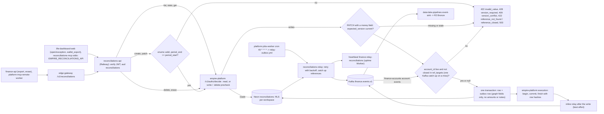

# 01 — Business process (As-Is / To-Be)

finance-reconciliations-api คือ cell ของ finance suite ที่เก็บผลการกระทบยอดบัญชี (account) กับ statement หรือ export ในหนึ่งช่วงเวลา (แหล่งที่มา ยอดที่คาด ยอดที่กระทบได้ ส่วนต่าง และสถานะ open / matched / exception / closed) ผู้ใช้คือ owner ผ่าน life-dashboard-web, finance-api (export และ erase) และ MCP; ทุกการเขียนส่ง event ที่มีแต่ข้อมูลอ้างอิงไป Kafka `finance.events.v1`

Last reviewed: 2026-11-27 · commit `4f53eae`

## As-Is (จากโค้ดวันนี้)

Sources: `cell.yaml`, `pyproject.toml` (platform-cellkit 1.1.1, entry points), `.github/workflows/relay-outbox.yml`, `migrations/0003_finance_events.sql`, `migrations/0004_cross_references.sql`, `README.md`, `PRODUCT.md`, `specs/005-finance-events-kafka/spec.md`, `specs/006-cross-service-references/spec.md`, `specs/008-workspace-erase/spec.md`, `specs/009-money-patch-version/spec.md`; platform-cellkit `v1.1.1` `src/cellkit/app.py`, `relay.py`, `refs.py`, `server.py`, `gateway.py`; callers: finance-api `src/finance_api/app.py` (`RESOURCES`, `SOURCES`), life-dashboard-web `lib/cells/finance.ts`, `lib/cells/owner-cash.ts`, platform-jobs-worker `src/jobs.ts`

ข้อเท็จจริงสำคัญจากโค้ด:

- resource เดียว `reconciliation` ที่ `/v1/reconciliations`: list (filter `account_id`, `status`, `source_type`, ช่วงวันที่ `<field>_from` / `<field>_to` ของ `period_start`, `period_end`, `reconciled_at`), stats, get, get-by-legacy-id, create (`Idempotency-Key`), patch, delete, `POST /v1/reconciliations/erase` (batch 1–500 ค่าเริ่ม 200, `confirm` ต้องเท่ากับ workspace ของผู้เรียก)
- `reconciliations-mcp` (stdio) มี tool `reconciliations.reconciliation.list|get|create|update|delete` ที่เรียก API ด้วย token ของผู้เรียก (`EMPIRE_MCP_READONLY=1` = อ่านอย่างเดียว)
- ยอดเงิน 3 ช่อง (`expected_amount`, `reconciled_amount`, `difference_amount`) เป็น `money` ที่ไม่ถูกตรวจกันเอง: cell เก็บส่วนต่างที่ได้รับมา ไม่คำนวณเอง
- event ใส่เฉพาะ `account_id`, `period_start`, `period_end`, `source_type`, `currency`, `status` (`graph` ใน `cell.yaml`)
- cell นี้ไม่มี `referenced_by` จึงลบได้เสมอ ส่วน `account_id` ถูกตรวจกับสำเนา account ที่มาจาก event (SPEC-006) ไม่ได้เรียก finance-accounts-api ตรง
- finance-api อ่าน cell นี้เฉพาะใน export และลบใน erase ขั้นแรก ไม่ได้อยู่ใน `/v1/overview`
- life-dashboard-web เรียกผ่าน `EMPIRE_RECONCILIATIONS_API` ซึ่ง URL จริง (ตรงหรือผ่าน gateway) อ่านจากโค้ดไม่ได้ [ต้องยืนยัน]
- โหมด `GATEWAY_ASSERTION_MODE` (off / report / enforce) และโหมด signed events ที่ production ตั้งไว้ อ่านจากโค้ดไม่ได้ [ต้องยืนยัน]

## To-Be (จาก `PRODUCT.md` §Measures และ `specs/004-identity-issuer-trust/spec.md`)

ไม่มีแผนภาพ To-Be ของกระบวนการ: specs 001–009 อยู่ในโค้ดแล้ว เหลือเพียงสิ่งที่เอกสารเขียนไว้ว่ายังไม่ทำ:

- `PRODUCT.md` §Measures (proposed, ยังไม่มีอะไรเก็บ): reconciliation ที่ `open` หรือ `exception` เกิน 30 วัน, account ที่ไม่มี `matched` หรือ `closed` ใน 35 วัน, 5xx และ p95 latency ของ `/v1/reconciliations`
- `specs/004-identity-issuer-trust/spec.md`: โค้ดรับ issuer ที่สอง (platform-identity) ได้แล้ว แต่การเปิดใช้ใน production ต้องได้ owner go แยก

## Gap

| ID | As-Is → To-Be | Status | Owner | Evidence |
|---|---|---|---|---|
| G1 | ไม่มีอะไรเก็บ measures → วัด reconciliation ที่ค้าง open/exception เกิน 30 วัน และ account ที่ไม่ถูกกระทบยอดใน 35 วัน | todo | claude | `PRODUCT.md` §Measures ("nothing collects them yet") |
| G2 | รองรับ issuer platform-identity ในโค้ดแล้ว → owner go ให้เปิดใน production (สถานะตัวแปรจริง [ต้องยืนยัน]) | decide | owner | `specs/004-identity-issuer-trust/spec.md` Status; platform-cellkit `src/cellkit/server.py` `_identity_trust` |
| G3 | `PRODUCT.md` ยังเขียนว่า `account_id` ไม่ถูกตรวจกับ accounts → แก้ให้ตรงกับ SPEC-006 (ตรวจกับ `ref_targets`, refuse `closed`) | todo | claude | `PRODUCT.md` §Capabilities; `cell.yaml` `references: finance-accounts.account`; `specs/006-cross-service-references/spec.md` |

## Open questions

- life-dashboard-web และ cell นี้คุยกันตรงหรือผ่าน edge gateway และ cell ตั้ง `GATEWAY_ASSERTION_MODE` เป็น enforce แล้วหรือยัง (finance-api `src/finance_api/cells.py` เขียนว่า gateway ทำให้ cell ปฏิเสธการเรียกตรงได้)
- `PRODUCT.md` บอกว่า finance-portfolio-web อ่าน `/api/finance/v1/reconciliations` ผ่าน `FINANCE_API_BASE_URL`; ปลายทางนั้นถึง cell นี้หรือไม่ [ต้องยืนยัน]
- ใครเขียน reconciliation แบบ `wallet_export` ที่ `lib/cells/owner-cash.ts` อ่าน (ไม่พบ writer อัตโนมัติในโค้ดที่อ่าน) [ต้องยืนยัน]
